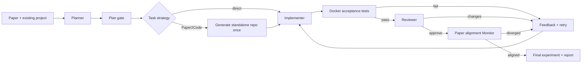

# PaperFusion

**Turn a paper method into an inspectable change to an existing Python application.** PaperFusion plans integration, lets a coding agent edit a bounded workspace, runs immutable checks, reviews actual code, and records paper alignment and experimental results. It began as my personal OpenCode POC; this version uses LangGraph and LangChain with a DeepSeek-compatible API and runs independently of OpenCode.

The [live RRF case report](examples/rrf/live-report.html) shows a real model run. The agent replaced a search app's first-list ranking stub with Reciprocal Rank Fusion from [Cormack, Clarke & Büttcher (SIGIR 2009)](https://plg.uwaterloo.ca/~gvcormac/cormacksigir09-rrf.pdf). Eight containerized acceptance tests passed. On four **synthetic** queries, nDCG@3 rose on one, fell on two, and tied on one. This demonstrates method integration; it does **not** reproduce the paper's TREC or LETOR benchmarks. The report includes the model/tool trace, code diff, tests, and role decisions.

## See it in two minutes

**Without an API key:**

```powershell
py -3.12 -m venv .venv
.\.venv\Scripts\python.exe -m pip install -e ".[dev]"
docker build -f Dockerfile.runner -t paperfusion-runner:0.2 .
.\.venv\Scripts\python.exe -m paperfusion.cli run --mode replay --executor docker --auto-approve --output runs/replay
```

Open `runs/replay/report.html`. Replay uses a declared scripted fixture with a rank-offset bug on attempt one. The controller runs real checks, sees failure, retries, and accepts the corrected fixture. The report labels every role as a replay and records **zero** model calls.

**With a DeepSeek key:** copy `.env.example` to `.env.local`, set `OPENAI_API_KEY` there, and run:

```powershell
.\.venv\Scripts\python.exe -m paperfusion.cli run --mode live --executor docker --auto-approve --output runs/my-live-run
```

`OPENAI_BASE_URL=https://api.deepseek.com` and `OPENAI_MODEL=deepseek-flash` are public defaults. `DEEPSEEK_API_KEY` is also accepted. The key stays on the host; test containers receive neither the key nor network access. For manual plan review, omit `--auto-approve`, inspect `plan.json` and `report.html`, then run `paperfusion resume runs/my-live-run --approve`. Run `paperfusion doctor` to check setup.

## Workflow



LangGraph saves checkpoints in SQLite. Each role is a bounded LangChain tool loop. Only Implementer may write the frozen task's listed files; Reviewer and Monitor must inspect actual code before approving. Tools reject escaping paths and junctions. The controller records file hashes, role inputs/outputs, model usage, test logs, attempts and the final diff. Interrupted roles can resume using receipts and pre-role snapshots. Three failed attempts pause the run for a recorded decision.

The Docker executor runs tests with a read-only root, read-only source and acceptance mounts, no network or Linux capabilities, and CPU, memory, process and time limits. The controller and model client remain outside the container. `--executor local-trusted` is allowed only for the scripted replay fixture.

## Paper2Code integration

The vendored [Paper2Code](paper2code/README.md) repository (Apache-2.0, commit `ba9169978043d5799c8d4f4a0963e6b66a24c2e1`) supplies Planning, Analyzer and Coding. PaperFusion's [checked wrapper](p2c_tools/p2c_wrapper.py) checks exit codes and required outputs, rejects unsafe generated filenames, and copies the generated config. A DeepSeek runtime shim logs tokens without inventing unsupported USD prices. The vendor source remains intact. Tasks selecting `p2c` share one versioned generated repository.

The RRF integration case uses `analysis=provided`: a maintainer-written summary cross-checked against page one of the paper. This is explicitly **not P2C output**. A separate [Paper2Code live smoke test](examples/rrf/P2C_CASE.md) completed Planning, Analyzer and Coding against a structured RRF method note, then corrected one generated test expectation and passed all 230 generated tests. For the full workflow, provide structured paper JSON and use `--analysis p2c`. A PDF needs conversion to the expected JSON format. P2C-generated code is reference material for adaptation, not proof of experimental reproduction.

## Evidence and limits

- `runs/<id>/state.json` and `checkpoints.sqlite`: state, attempts, durable transitions.
- `runs/<id>/steps/*`: role inputs, structured results, tool traces, token counts.
- `runs/<id>/checks/*`: test output and exit code per attempt.
- `runs/<id>/changes.diff`, `evaluation.json`, `report.html`: actual code change and result.
- Paper-alignment reviews are model judgments. Controller-owned tests are independent behavioral checks. Original benchmark reproduction needs the original dataset and protocol.
- API costs remain unknown unless explicit provider prices are supplied; token counts are recorded.
- This is a single-process local tool, with no claim of multi-user hosting or cloud deployment.

I built PaperFusion to make the work after reading a paper visible: preserving existing interfaces, checking results against the source, and diagnosing failures. The [architecture notes](docs/ARCHITECTURE.md) describe the boundaries; [case notes](examples/rrf/CASE.md) distinguish measured results from the paper's claims. The original POC instructions remain in [`legacy/`](legacy/). [Third-party notices](THIRD_PARTY.md) identify what I did not author.

## Verify

```powershell
.\.venv\Scripts\python.exe -m pytest --basetemp .test-tmp
.\.venv\Scripts\ruff.exe check paperfusion p2c_tools tests
docker build -f Dockerfile.runner -t paperfusion-runner:0.2 .
```

CI runs these gates plus the Docker replay without an API key.
